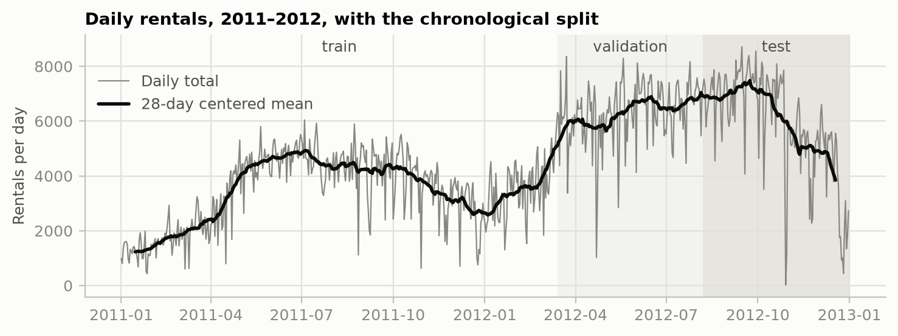
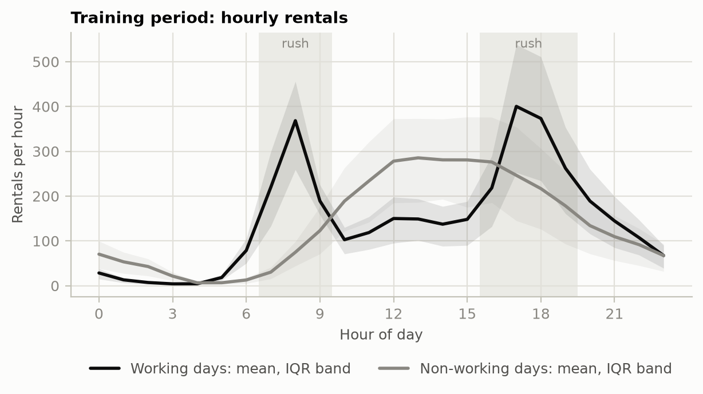
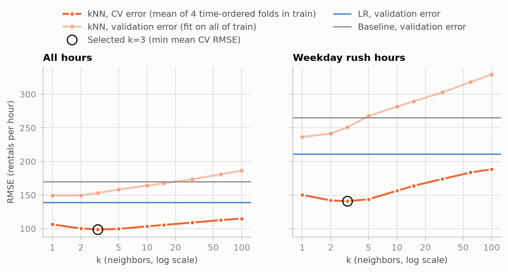
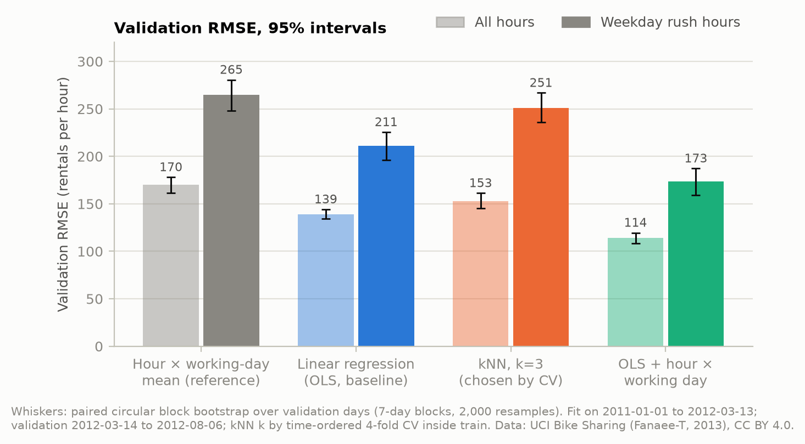
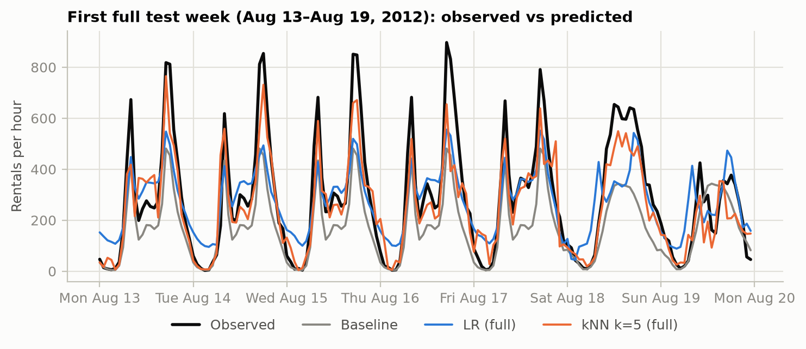

# How Accurate Is Hourly Bike Sharing Demand Estimation? Results so far

ESE 5420 final project · group ESE_5420_112 (Jinge, Shuo, Yujie) · status 2026-11-08 · raw outputs: `results/val.md` (current), `results/2026-10-16/` and `results/2026-11-08/` (earlier test scorings)

**Question.** Given observed weather and calendar information, how accurately do linear regression (OLS) and k-nearest neighbors (kNN) estimate hourly bike rentals, and which one is better during weekday rush hours (working days, 07:00–09:59 and 16:00–19:59)?

**Status.** The setup follows the submitted proposal (`proposal.md`) plus the changes asked for in the proposal feedback and the baseline checkpoint (section 1). Validation results are final for this setup. The final test evaluation has **not** been run with it yet. The test set was already scored twice under earlier setups (2026-10-16 and 2026-11-08); section 5 reports those runs, labeled as superseded. They were not used to choose anything.

## Key findings (validation, Mar 14–Aug 6, 2012; models fit on the training days)

1. **OLS beats kNN.** OLS has RMSE 139.2 (95% interval 134.1 to 144.2); kNN with k = 3, chosen by cross-validation, has 153.0 (145.2 to 161.3). The hour × working-day mean (reference) has 169.9.
2. **At weekday rush hours OLS is clearly better.** OLS 210.9, kNN 250.9. The rush-hour difference kNN − OLS is +39.9 (+30.5 to +49.4).
3. **Letting the hourly profile depend on the day type matters most.** OLS + hour × working day reaches 114.1 overall and 173.4 at rush hours, the best of all models.
4. **Every model underpredicts the validation period**, most of all at rush hours (mean error −128 to −232 rentals per hour). Demand grew 121% between the same early-year windows of 2011 and 2012, and the training days are mostly 2011. OLS follows the growth through the year term; kNN cannot predict above the levels its neighbors saw.
5. **The best k depends on the period.** Time-ordered CV inside the training days picks k = 3 (folds prefer 3 or 5); the validation curve alone would pick k = 1.

## 1. Setup

| | |
|---|---|
| Data | UCI Bike Sharing `hour.csv`: 17,379 hourly rows, 2011-01-01 to 2012-12-31 |
| Target | `cnt` (total rentals per hour) |
| Inputs (10) | one-hot `hr`, `weekday`, `mnth`, `weathersit`; binary `yr`, `workingday`, `holiday`; standardized `temp`, `hum`, `windspeed` (53 encoded columns) |
| Excluded | `instant` (ID); `casual` and `registered` (they sum to `cnt`); `season` and `atemp` (redundant) |
| Split | chronological, by whole day: train 438 days (2011-01-01 to 2012-03-13), validation 146 days (to 2012-08-06), test 147 days (to 2012-12-31) |
| Baseline | OLS linear regression (no tuning parameter) |
| Comparison | kNN regression (Euclidean distance, uniform weights), k ∈ {1, 2, 3, 5, 10, 15, 30, 60, 100} |
| Tuning | time-ordered 4-fold CV inside the training days: each fold fits on all earlier training days and scores the next 73 days; k minimizes mean CV RMSE |
| Reference | training mean of `cnt` for each (`hr`, `workingday`) cell, falling back to the overall training mean |
| Extension | OLS + hour × working-day interaction |
| Ablation | calendar only: the same models without `weathersit`, `temp`, `hum`, `windspeed` |
| Metrics | RMSE, MAE and bias (mean of prediction − observed), all hours and weekday rush hours |
| Uncertainty | paired circular block bootstrap over days (7-day blocks, 2,000 resamples, seed 0), percentile intervals |

Encoders and the scaler are fit only on the data each model is fit on. Nothing else is random.

**Protocol.** (1) Tune k by CV inside train. (2) Fit on all training days and score validation. (3) Freeze every choice. (4) Refit on train + validation and score the test set once; the main answer is the rush-hour test RMSE difference kNN − OLS with its interval, plus a block-length check (1 to 21 days).

**Changes since the proposal.**
- The kNN grid was widened from {5, 15, 30, 60} (feedback: include small k and 100).
- k is chosen by time-ordered CV instead of the validation RMSE (checkpoint rules). Validation is now an unseen set.
- OLS + hour × working day was added as a second linear model (feedback).
- The main answer is stated as kNN − OLS at rush hours (feedback).
- **Deviation:** the proposal kept the test set for the very end, but we scored it twice before the analysis was final (section 5).

## 2. Data and cleaning



**Checks (all pass).**
- No missing values and no duplicate (date, hour) rows.
- `cnt = casual + registered` on every row.
- `weekday`, `yr` and `mnth` agree with the date.
- `workingday` is 1 exactly on Monday–Friday non-holidays.

No rows were dropped and no values were changed.

| Issue | Rows | Where | Handling |
|---|---|---|---|
| Missing hours (no row) | 165 | 76 days, mostly 01:00–05:00; train 123, validation 2, test 40. Hurricane Sandy (2012-10-29/30) has 1 and 11 recorded hours | not imputed; metrics use recorded hours |
| `hum` = 0 | 22 | all on 2011-03-10 (train); not physically plausible | kept |
| `windspeed` = 0 | 2,180 | 12.5% of rows, all splits; may be missing values recorded as 0 | kept |
| `weathersit` = 4 | 3 | heavy rain/snow, all in train | kept; unseen categories are ignored by the encoder |

- **A missing hour is ambiguous.** `cnt` is never 0, so a missing hour may mean zero rentals or an outage.
- **Demand grew fast.** In the same Jan 1–Mar 13 window, mean hourly rentals rose from 66.8 (2011) to 147.9 (2012), +121%. The test period (Aug–Dec 2012) is the busiest stretch, then demand declines into winter.
- **Collinear calendar columns.** Every holiday falls on a weekday, so `workingday`, `holiday` and the weekday dummies are collinear. Least squares still gives unique predictions (minimum-norm solution).



Working days have two sharp commute peaks (8 h and 17–18 h); non-working days have one broad midday hump. A model must let the hourly profile depend on the day type to fit both. The reference and kNN can; plain OLS cannot, because it adds one hour effect to one working-day effect.

## 3. Choosing k



| k | 1 | 2 | 3 | 5 | 10 | 15 | 30 | 60 | 100 |
|---|---|---|---|---|---|---|---|---|---|
| Mean CV RMSE (4 folds in train) | 106.4 | 100.3 | **98.9** | 99.7 | 103.5 | 105.6 | 109.1 | 112.7 | 115.1 |
| Validation RMSE (fit on train) | 149.4 | 149.5 | 153.0 | 158.3 | 164.2 | 167.4 | 173.5 | 180.9 | 186.3 |
| Training RMSE | 0.5 | 44.6 | 54.7 | 65.3 | 74.1 | 77.5 | 81.9 | 88.0 | 93.4 |

These are results with weather. Calendar-only kNN is unstable: its CV picks k = 30 (fold optima 30, 30, 30, 3), which scores 185.2 on validation.

- **CV picks k = 3.** The four folds (May 27, 2011 to Mar 13, 2012) prefer k = 3, 3, 5 and 5. On validation alone the minimum would be k = 1 (149.4, with k = 2 at 149.5).
- **Training error rises with k**, as expected: at k = 1 each training hour is its own neighbor.
- **Validation error has no U-shape.** Much of it is bias that no k removes: −80 to −85 rentals per hour at every k, because only 16–20% of neighbors come from 2012.
- **Larger k averages over other hours.** With one-hot encoding, 8 a.m. vs 9 a.m. counts as just as different as 8 a.m. vs 8 p.m. For validation rush hours, the share of neighbors from the same hour falls from 73.5% at k = 3 to 28.7% at k = 100.
- **On average across the CV folds OLS is better than every k** (CV RMSE 94.0 vs 98.9).

## 4. Validation results



| Model | Features | RMSE [95% interval] | MAE | Bias | Rush RMSE [95% interval] | Rush MAE | Rush bias |
|---|---|---|---|---|---|---|---|
| Reference: hour × working-day mean | — | 169.9 [161.6, 178.1] | 126.0 | −120.6 | 264.9 [248.1, 280.6] | 240.1 | −232.1 |
| **Baseline: OLS** | with weather | **139.2 [134.1, 144.2]** | 106.2 | −18.2 | **210.9 [196.2, 225.5]** | 178.0 | −166.3 |
| kNN, k = 3 | with weather | 153.0 [145.2, 161.3] | 110.3 | −83.3 | 250.9 [236.1, 266.9] | 220.5 | −215.4 |
| *OLS + hour × working day* | with weather | *114.1 [108.5, 119.6]* | 88.4 | −17.8 | *173.4 [159.2, 187.3]* | 144.2 | −128.2 |
| OLS | calendar only | 145.6 | 112.8 | −13.4 | 214.4 | 180.6 | −163.2 |
| kNN, k = 30 | calendar only | 185.2 | 137.2 | −117.6 | 296.1 | 267.8 | −263.2 |
| OLS + hour × working day | calendar only | 121.7 | 95.5 | −13.2 | 178.7 | 148.2 | −125.0 |

| Difference (< 0: first is better) | All hours | Rush hours |
|---|---|---|
| **kNN − OLS** | +13.8 [+7.9, +20.0] | **+39.9 [+30.5, +49.4]** |
| kNN − (OLS + hour × working day) | +38.9 [+33.0, +45.4] | +77.4 [+67.8, +86.9] |

- **OLS beats kNN** on validation, overall and at rush hours; both intervals exclude zero.
- **kNN has a large negative bias** (−83 overall, −215 at rush hours). The validation period is spring and summer 2012, busier than almost all training days, and kNN can only average days it has seen.
- **Weather helps OLS a little** (139.2 vs 145.6 calendar-only).
- **The interaction model is best everywhere.** The structural limit of plain OLS (one hourly profile for all days) costs more than its linearity.

## 5. Earlier test scorings (superseded; not used for any choice)

The test set (Aug 7–Dec 31, 2012) was scored twice before the current setup was fixed:
- **2026-10-16**, with the draft setup: grid {5, 15, 30, 60}, k picked on validation (k = 5), and a bootstrap over single days.
- **2026-11-08**, after the proposal feedback: widened grid, k picked on validation (k = 1), and a 7-day block bootstrap.

All models were refit on train + validation.

| Test RMSE (all / rush) | 2026-10-16 | 2026-11-08 |
|---|---|---|
| Reference | 144.9 / 234.4 | 144.9 / 234.4 |
| OLS | 135.5 / 203.6 | 135.5 / 203.6 |
| kNN | 120.9 / 204.5 (k = 5) | 128.0 / 206.3 (k = 1) |
| OLS + hour × working day | 106.9 / 168.1 | 106.9 / 168.1 |
| kNN − OLS, all hours | −14.7 [−21.7, −6.9] | −7.6 [−17.5, +2.3] |
| kNN − OLS, rush hours | +0.9 [−12.6, +15.0] | +2.7 [−11.2, +17.3] |
| kNN − (OLS + hr × wd), rush hours | +36.4 [+21.4, +52.1] | +38.2 [+19.2, +55.8] |

These runs suggest where the final analysis should look. Each point will be re-checked on the final run.
- **The ranking depends on recent data.** On test, the gap between kNN and OLS is much smaller than on validation. Refitting on train + validation adds spring and summer 2012, which helped kNN far more than OLS: on 2026-10-16, test RMSE improved by 38.9 for kNN and by 10.2 for OLS compared with a train-only fit.
- **At rush hours OLS and kNN were tied in both runs.** OLS + hour × working day beat kNN clearly in both.
- **OLS predicts a commute peak on weekend mornings** that does not happen. Its one hourly profile is shared by all days.
- **kNN's worst days were cold or rainy days** whose nearest neighbors were low-demand 2011 days.
- **Every model underpredicted rush hours** (observed up to 977 rentals per hour; OLS never predicted above 574).



## 6. Limitations

- **The test set is no longer untouched.** Scoring it early does not change the models, but the final test result will be the third look at it. We report all three runs.
- **One period.** The test period covers only Aug–Dec 2012, in a year of strong growth.
- **Data issues kept as is.** Missing hours, `hum` = 0 and `windspeed` = 0 were not imputed.
- **kNN distance.** It uses unweighted Euclidean distance on one-hot features, which the 47 one-hot columns dominate. Weighting or a cyclic hour encoding could change its results.
- **Additive OLS.** The year effect adds the same number of rentals in every month, while growth is closer to proportional. A log-count target or an hour × year interaction would capture that; neither has been tested.

## 7. Next steps (before the early paper draft, Monday 16 November)

- **Jinge:** treat the `hum` and `windspeed` zeros as missing (validation only); write the data section.
- **Yujie:** down-weight one-hot columns in the kNN distance (CV inside train); run the calendar-only ablation.
- **Shuo:** rush-hour error analysis and figures on validation, the bootstrap block-length check, and draft integration.
- **Final test run:** once the analysis is frozen.

## Reproduce

```bash
conda env create -f environment.yml && conda activate ese5420
python bike.py       # data checks and split sanity
python run.py        # CV tuning and validation results -> results/val.md, val_k_curve.png, baseline.png
python run.py test   # final test evaluation: run once, after the analysis is frozen
```

## Data credit

Fanaee-T, H. (2013). *Bike Sharing* [Dataset]. UCI Machine Learning Repository. https://doi.org/10.24432/C5W894. Licensed under CC BY 4.0 (https://creativecommons.org/licenses/by/4.0/). `data/raw/` holds the original files unmodified; all processing is in `bike.py` and `run.py`.
